<div align="center">


# Jiyue 霁月

**A local-first Markdown notes app for Windows, written in Rust.**
Your notes stay plain `.md` files in a folder you choose.

[English](README.en.md) | [简体中文](README.md)

[](https://github.com/limitcool/jiyue/actions/workflows/ci.yml)
[](#licence)


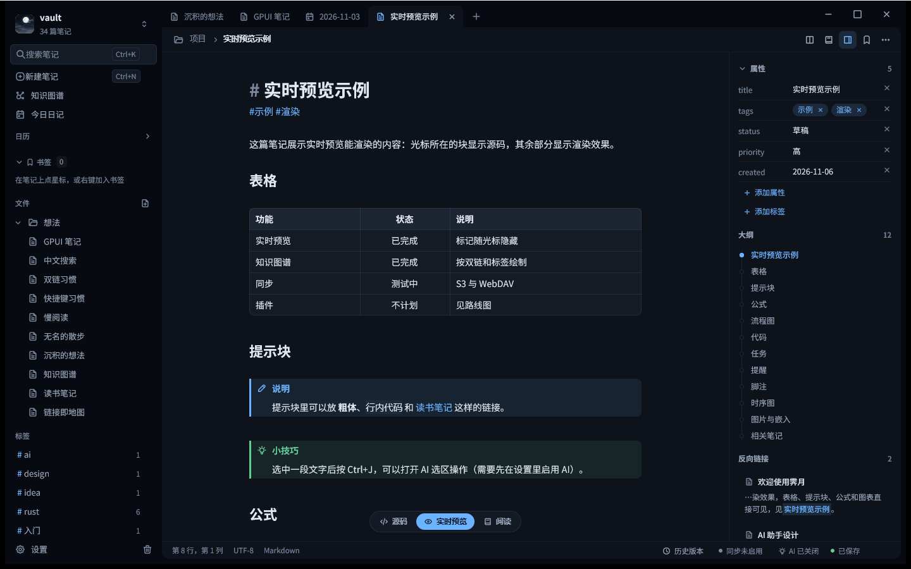

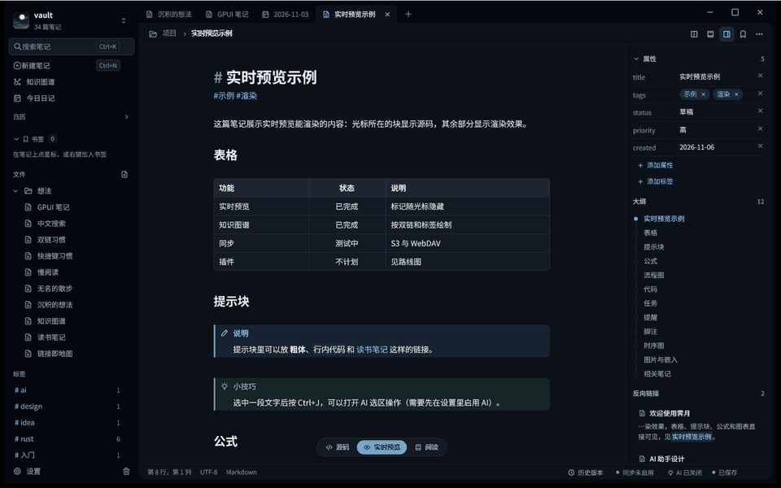

</div>

## About the name

**霁月** (pinyin *jì yuè*, written **Jiyue**, pronounced roughly "jee-yweh") means "the moon after the rain clears". 霁 (*jì*) describes rain stopping and the sky clearing; 月 (*yuè*) is the moon.

The Song-dynasty poet Huang Tingjian praised the philosopher Zhou Dunyi as having a mind "like a bright breeze and a clear moon after rain" (光风霁月). The phrase became an idiom for an open, clear and upright character, and also for fine, clear weather after rain.

We chose it because we want a notes app that feels like that sky: calm, clear and not in the way. The app icon is a full moon coming out from behind the clouds.

## Why Jiyue

- **Local first.** A note is a `.md` file in a normal folder. There is no account, no database and no proprietary format. Remove Jiyue and your notes are still readable.
- **Works with Obsidian vaults.** Open an existing vault folder as it is. `[[wikilinks]]`, `![[embeds]]`, `^block` references and YAML properties are understood. Jiyue does not read or change `.obsidian`.
- **A native app.** The interface is GPUI, the GPU-accelerated UI framework from the Zed editor, so the app is a single program with no browser inside.
- **Chinese first.** Pinyin input works in every text field, the full-text index handles Chinese without a dictionary, and the interface, menus and sample notes are written in Simplified Chinese.

## Features

### Writing

- **Live preview.** The note is shown rendered. The line under the caret shows its Markdown source, and markers elsewhere stay hidden. Switch between Live, Read (rendered only) and Source in the bottom bar.
- **Rendered blocks.** Tables, callouts (note, tip, warning, danger, and foldable ones), code blocks with a copy button, task lists, images, note embeds and footnotes are drawn in the preview.
- **Math and diagrams.** LaTeX formulas are rendered without a browser (inline and block). Mermaid flowcharts and sequence diagrams are drawn in the preview.
- **Slash menu.** Type `/` at the start of a line to insert headings, lists, tasks, quotes, dividers, code blocks, tables, callouts, links, footnotes, images, math, Mermaid diagrams, the date, a template or a property block. Chinese names and pinyin match.
- **Properties.** YAML frontmatter is shown as editable properties in the right panel.

### Knowledge

- **Wikilinks and backlinks.** `[[Note]]` links open with Ctrl+click. The right panel lists backlinks, unlinked mentions and an outline of headings.
- **Knowledge graph.** Notes and their links as a graph, with tag filters and an option to hide orphan notes (Ctrl+G).
- **Tags.** Tags in the body or in properties are listed in the sidebar with their counts.
- **Daily notes and calendar.** Today's note with Ctrl+Shift+D, a calendar in the sidebar, and previous and next day commands.
- **Templates.** Insert a template into a note, or create a new note from one.
- **Bookmarks.** Star a note, or a heading, to keep it in a sidebar section.

### Search and navigation

- **Full-text search** of the whole vault (Ctrl+Shift+F). Chinese is indexed by character pairs, so no word list is needed. Queries support phrases, `-exclusion`, `OR`, and the filters `tag:`, `path:`, `file:` and `title:`. Results show highlighted snippets.
- **Find and replace** inside the open note (Ctrl+F, Ctrl+H).
- **Quick switcher** (Ctrl+K) and **command palette** (Ctrl+P), which lists every command, including the ones without a shortcut.
- **Tabs and split view.** Several notes in tabs, and a note split beside another (Ctrl+\).

### Safety and history

- **Atomic saves.** A note is written to a temporary file and renamed over the old one, so a failed write keeps the old text.
- **Recovery.** Unsaved text is kept in a recovery copy while you edit, and offered back after a crash. A panic is logged to `.jiyue/crash.log`.
- **Local version history.** Each save keeps a version under `.jiyue/history`. You can compare any version with the current text and restore it; the current text is saved as a version first.
- **Trash.** Deleted notes go to `.trash`, and can be restored from there.
- **Export.** A note becomes a self-contained HTML page, and a whole vault becomes a static HTML site. For PDF, print the HTML from a browser.

### Optional features (off by default)

- **Sync** to an S3-compatible bucket (with optional remote version history) or to a WebDAV folder, with three-way merge and conflict copies. See [docs/sync.md](docs/sync.md).
- **AI assistant, bring your own key.** OpenAI-compatible and Anthropic providers. Keys are stored in plain text in a local `credentials.toml` (owner-only), or read from an environment variable or a command. Nothing is sent until you turn AI on and ask for something. See [docs/ai.md](docs/ai.md).
- **MCP server.** `jiyue-mcp` lets an MCP client such as Claude Desktop or Claude Code search, read and (unless started read-only) edit the notes of a vault. See [docs/mcp.md](docs/mcp.md).

### Look and feel

- **Five themes:** Paper, Ink, Moss, Graphite and Fog.
- **Customisable shortcuts.** Change any command's keys in Settings. See [docs/shortcuts.md](docs/shortcuts.md).

## Screenshots

<p align="center">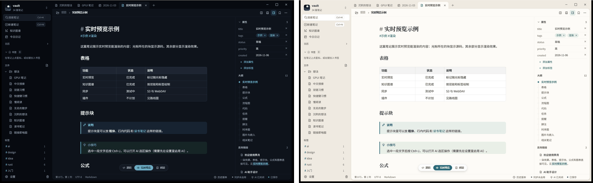<br><sub>Ink (left) and Paper (right).</sub></p>

<table>
  <tr>
    <td align="center"><a href="docs/images/hero-paper.png">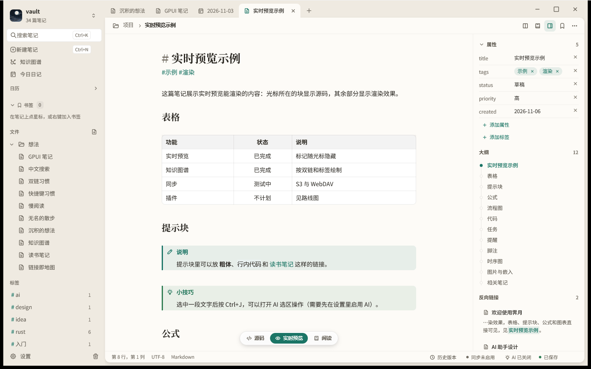</a><br><sub>Paper theme, live preview of a note.</sub></td>
    <td align="center"><a href="docs/images/widgets.png">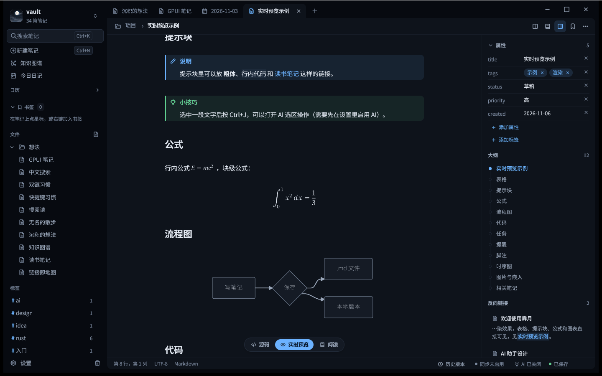</a><br><sub>Callouts, a formula and a Mermaid flowchart in the preview.</sub></td>
  </tr>
  <tr>
    <td align="center"><a href="docs/images/graph.png">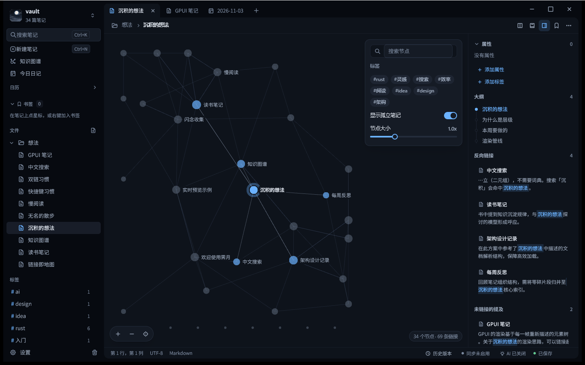</a><br><sub>The knowledge graph, built from wikilinks and tags.</sub></td>
    <td align="center"><a href="docs/images/search.png">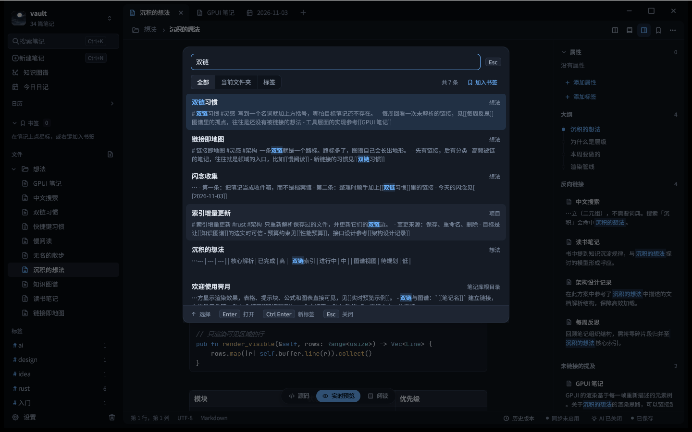</a><br><sub>Full-text search with a Chinese query and highlighted results.</sub></td>
  </tr>
  <tr>
    <td align="center"><a href="docs/images/slash-menu.png">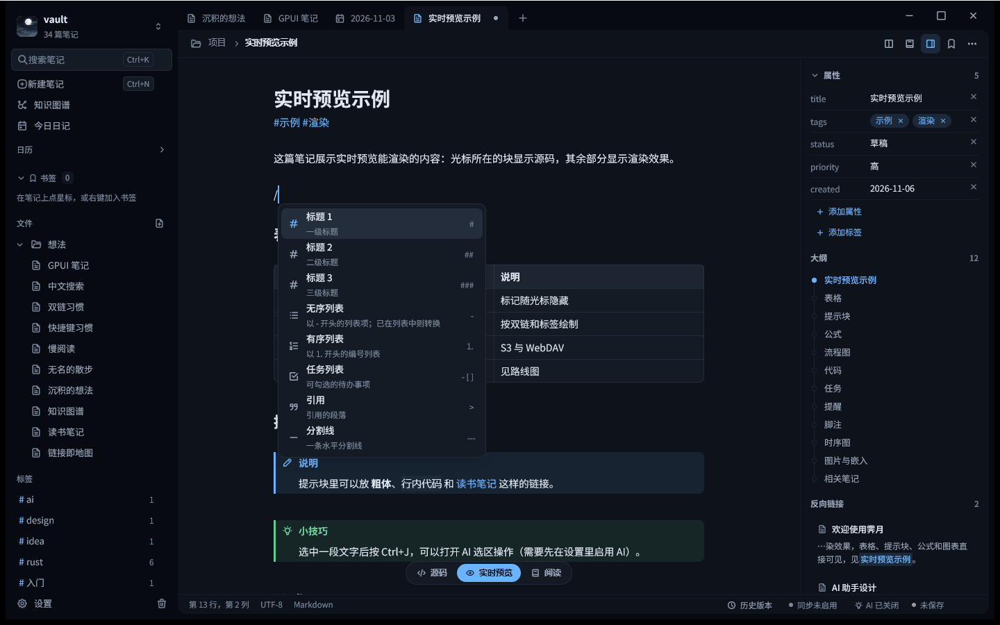</a><br><sub>The <code>/</code> insert menu.</sub></td>
    <td align="center"><a href="docs/images/split-view.png">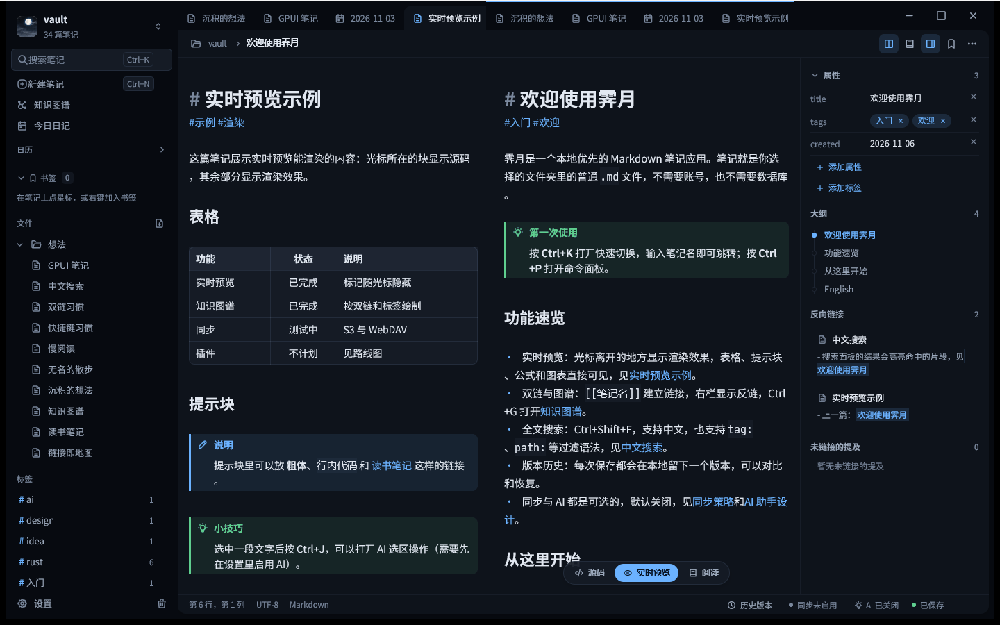</a><br><sub>Split view: two notes side by side.</sub></td>
  </tr>
  <tr>
    <td align="center"><a href="docs/images/palette.png">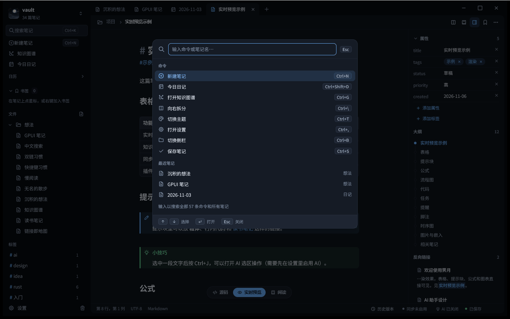</a><br><sub>The command palette (Ctrl+P).</sub></td>
    <td align="center"><a href="docs/images/history.png">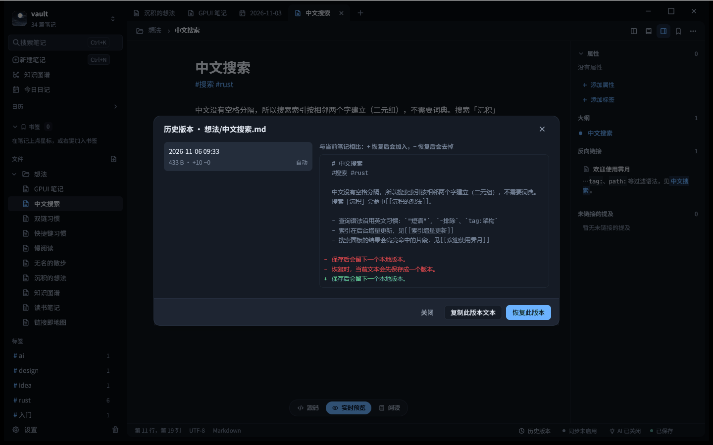</a><br><sub>Local version history: compare a version with the current text.</sub></td>
  </tr>
  <tr>
    <td align="center"><a href="docs/images/sync-settings.png">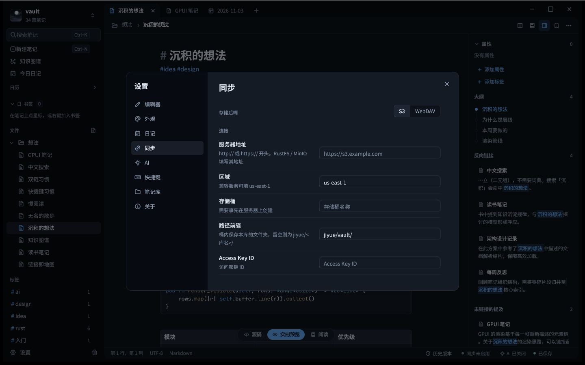</a><br><sub>The sync settings page (empty, no server configured).</sub></td>
    <td align="center"><a href="docs/images/bookmarks.png">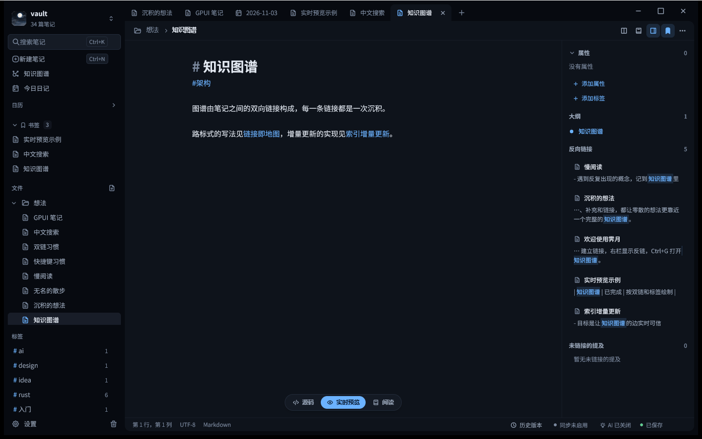</a><br><sub>Bookmarks section in the sidebar.</sub></td>
  </tr>
</table>

## Install

- **Windows 10 and 11, x64 and ARM64.** The release workflow builds an MSI installer per architecture (per user, no administrator rights; `Jiyue-<version>-x64.msi` and `Jiyue-<version>-arm64.msi`). The x64 build is the one the developer runs by hand. The ARM64 build is produced by CI and has not been run by hand on an ARM64 PC; the ARM64 MSI installs only on ARM64 Windows. No GitHub release has been published yet; until one is, build from source (below) or run `installer\build.ps1` (see [installer/README.md](installer/README.md)). The installers are not code-signed yet, so SmartScreen may warn.
- **macOS, Apple silicon and Intel.** CI builds the app on both and runs its tests, and the release workflow produces a `.dmg` containing `Jiyue.app` for each (`Jiyue_<version>_aarch64.dmg` and `Jiyue_<version>_x64.dmg`). The developer has not yet run the app by hand on either.
- **Linux, x86_64 and ARM64.** CI builds the app and runs its tests on both. The release workflow produces a `.deb` and (when its optional step succeeds) an AppImage for each. The ARM64 packages are built by CI only and have not been run by hand. The developer has not yet run the app by hand on macOS or Linux, so treat them as early. The ARM64 builds run only when the repository is public or the owner enables them; see [docs/ci.md](docs/ci.md).

## Quick start

```powershell
jiyue.exe --vault "D:\Notes"
```

- `--vault <folder>` opens a vault. The folder is created if it does not exist.
- Without `--vault`, Jiyue opens the vault you used last, or shows a chooser on the first run.
- Create a note with Ctrl+N and open one with Ctrl+K. Today's note is Ctrl+Shift+D.
- Notes autosave after a short pause; Ctrl+S saves at once.

Options: `--theme <paper|ink|moss|graphite|fog>` (default `ink`), and `--open <screen>` to start with a screen open (for example `palette`, `settings`, `graph`).

## Build from source

Requirements: Windows 10 or 11 (64-bit) and the Rust toolchain pinned in [rust-toolchain.toml](rust-toolchain.toml) (1.99.1; `rustup` installs it on first use). The code uses edition 2024.

```powershell
cargo run --release -p jiyue -- --vault "D:\Notes"
cargo build --release -p jiyue-mcp
```

The binaries are `target\release\jiyue.exe` and `target\release\jiyue-mcp.exe`. On Linux, the system packages used by CI are listed in [docs/ci.md](docs/ci.md#linux-system-packages).

## Keyboard shortcuts

Defaults. Every command can be given other keys in Settings (Ctrl+,, page 快捷键). The full list is in [docs/shortcuts.md](docs/shortcuts.md).

| Action | Keys |
| --- | --- |
| Quick switcher | Ctrl+K (or Ctrl+O) |
| Command palette | Ctrl+P |
| New note / today's daily note | Ctrl+N / Ctrl+Shift+D |
| Save | Ctrl+S |
| Search the vault | Ctrl+Shift+F |
| Find / replace in the note | Ctrl+F / Ctrl+H |
| Knowledge graph | Ctrl+G |
| Toggle the sidebar | Ctrl+B |
| Split right | Ctrl+\ |
| Cycle theme | Ctrl+T |
| Settings | Ctrl+, |
| AI assistant panel / selection actions | Ctrl+Shift+A / Ctrl+J |

## Your data and privacy

- Notes are `.md` files in the vault folder. Jiyue keeps its own data in a hidden `.jiyue` folder inside the vault. You can delete it at any time; you lose the history, recovery copies, search index and sync state, but not your notes.
- `.jiyue` holds the search index (`index/`), local history (`history/`), recovery copies (`recovery/`), the crash log (`crash.log`), the settings files for AI, sync, attachments, daily notes and templates (no secrets), and sync state (`sync/`). Deleted notes are in `.trash/`.
- Passwords and API keys are stored in `credentials.toml` in your user configuration folder, in plain text, readable only by your user account. They are never written to the vault, never synced and never logged. See [docs/configuration.md](docs/configuration.md).
- The network is used only for sync and AI, and only when you turn them on. There is no telemetry and no crash reporting. AI sends only what you ask for, and you see a preview of a question before it is sent. Folders and tags you exclude are never sent.

## Configuration

Settings live in TOML files: `config.toml` and `state.toml` in your user configuration folder, and `.jiyue/config.toml` inside each vault. Shortcuts are the `[keys]` section of `config.toml`. API keys and sync secrets go to `credentials.toml` (plain text, owner-only). Errors are shown with their file, line and column, and the app keeps running on defaults. Full reference: [docs/configuration.md](docs/configuration.md).

## Sync

Sync is optional. S3 is the preferred backend, and WebDAV is also supported. Changes on both sides are merged line by line where possible; overlapping edits create a conflict copy next to the note, and both versions are kept. Remote version history needs bucket versioning on S3, which Jiyue checks but never changes.

WebDAV is implemented, but its behaviour has not yet been verified against real servers. Test sync with a copy of your vault first. Details: [docs/sync.md](docs/sync.md).

## AI assistant

The AI assistant is off by default. You bring the provider, the base URL, the model names and the key. The side panel chats about the current note, the selection or the whole vault; the selection menu (Ctrl+J) rewrites, shortens, expands, translates, fixes or summarises the selected text. Results are shown as a diff, and nothing is written into a note until you accept it. Details: [docs/ai.md](docs/ai.md).

## MCP server

`jiyue-mcp` speaks the Model Context Protocol over stdio and works on one vault:

```powershell
jiyue-mcp --vault "D:\Notes" --read-only
```

It offers tools to list, read and search notes, to follow backlinks and tags, to read properties and the daily note, and (unless `--read-only` is given) to create and append notes, update a note with a hash check, and set properties. Deleting needs `--allow-delete`. Client configuration examples: [docs/mcp.md](docs/mcp.md).

## Project status

Jiyue is a **beta** for Windows. The editor, live preview, search, links, graph, history, export, sync and the MCP server are implemented; sync and AI are the parts with the least real-world testing. What is planned, and what is not, is in the [roadmap](ROADMAP.md).

## Contributing

See [CONTRIBUTING.md](CONTRIBUTING.md) for building, testing and the layout of the repository. Report security problems privately, as described in [SECURITY.md](SECURITY.md).

## Licence

Jiyue is dual-licensed under the [MIT licence](LICENSE-MIT) or the [Apache License 2.0](LICENSE-APACHE), at your option. Third-party components and their licences are listed in [THIRD_PARTY_NOTICES.md](THIRD_PARTY_NOTICES.md).

## Acknowledgements

Jiyue is built on the work of many open-source projects, among them:

- GPUI, the user interface framework from the [Zed](https://github.com/zed-industries/zed) editor.
- [tantivy](https://github.com/quickwit-oss/tantivy), the full-text search engine.
- [opendal](https://github.com/apache/opendal), the S3 and WebDAV storage layer.
- [pulldown-cmark](https://github.com/pulldown-cmark/pulldown-cmark), the Markdown parser.
- mermaid-rs-renderer, which draws Mermaid diagrams, and latex-rust, which renders formulas.
- [similar](https://github.com/mitsuhiko/similar) for diffs, [toml](https://github.com/toml-rs/toml) and [toml_edit](https://github.com/toml-rs/toml) for configuration, and [notify](https://github.com/notify-rs/notify) for file watching.
- [Tabler Icons](https://tabler.io/icons) (MIT), the icon set used in the interface.

The full list of crates and licences is in [THIRD_PARTY_NOTICES.md](THIRD_PARTY_NOTICES.md).
