<div align="center">


# 霁月 Jiyue

**一款本地优先的 Markdown 笔记应用，面向 Windows，用 Rust 编写。**
笔记就是你选的文件夹里的普通 `.md` 文件。

[English](README.en.md) | [简体中文](README.md)

[](https://github.com/limitcool/jiyue/actions/workflows/ci.yml)
[](#许可证)
[](https://github.com/limitcool/jiyue/releases/latest)


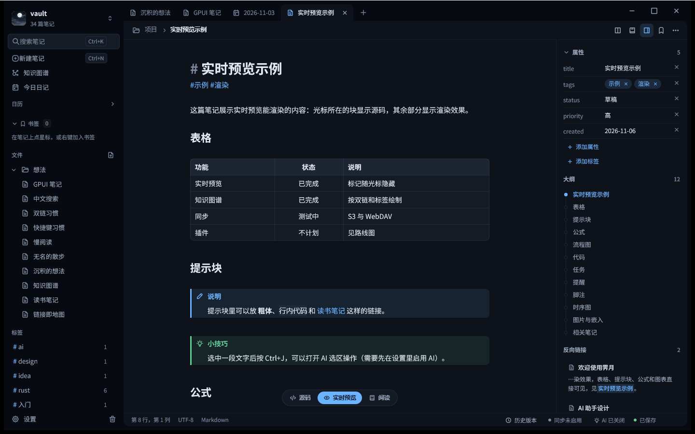

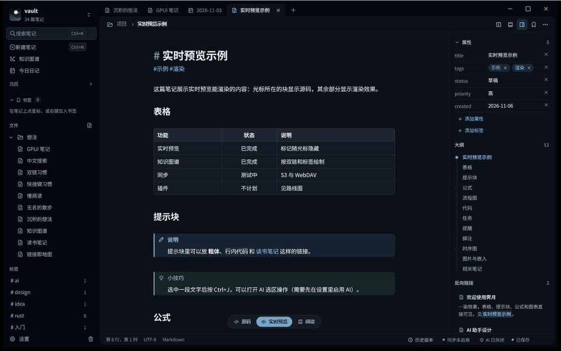

</div>

## 名字的由来

**霁月**（拼音 *jì yuè*，英文名 **Jiyue**，读作 “jee-yweh”）的字面意思是“雨过天晴之后的月亮”。“霁”指雨停云散、天色放晴，“月”是月亮。

宋代黄庭坚评价周敦颐“胸怀洒落，如光风霁月”，后来“光风霁月”成了成语，形容心胸开阔、清明磊落，也形容雨后清朗的好天气。

我们用这个名字，是想让笔记应用像雨后的夜空：安静，清澈，不抢戏。应用的图标就是云层散开后露出的一轮明月。

## 为什么是霁月

- **本地优先。** 一篇笔记就是普通文件夹里的一个 `.md` 文件。没有账号，没有数据库，也没有私有格式。即使不再使用霁月，笔记依然可以直接打开。
- **兼容 Obsidian 笔记库。** 可以直接打开已有的笔记库文件夹。`[[双链]]`、`![[嵌入]]`、`^块引用` 和 YAML 属性都能识别，霁月不读取也不修改 `.obsidian`。
- **原生应用。** 界面基于 GPUI（Zed 编辑器的 GPU 加速界面框架），整个程序就是一个可执行文件，里面没有浏览器。
- **中文优先。** 任何输入框都支持拼音输入；全文索引按字的二元组建立，不需要词典；界面、菜单和示例笔记都使用简体中文。

## 功能

### 写作

- **实时预览。** 笔记以渲染后的样子显示。光标所在的那一行显示 Markdown 源码，其他地方的标记隐藏。底部可以在「源码」「实时预览」「阅读」之间切换。
- **渲染的块。** 表格、提示块（注释、提示、警告、危险，还有可折叠的提示块）、带复制按钮的代码块、任务列表、图片、笔记嵌入和脚注都会在预览中绘制。
- **公式与图表。** LaTeX 公式（行内和块级）不依赖浏览器即可渲染。Mermaid 流程图和时序图会直接画在预览里。
- **斜杠菜单。** 在行首输入 `/`，可以插入标题、列表、任务、引用、分割线、代码块、表格、提示块、链接、脚注、图片、公式、Mermaid 图、日期、模板和属性块。中文名称和拼音都能匹配。
- **属性。** YAML 前置属性在右栏中以可编辑的属性形式显示。

### 知识管理

- **双链与反链。** `[[笔记名]]` 按住 Ctrl 点击即可打开。右栏列出反向链接、未链接的提及和标题大纲。
- **知识图谱。** 笔记和它们之间的链接画成一张图，可以按标签筛选，也可以隐藏孤立笔记（Ctrl+G）。
- **图谱缩放。** 在图谱上滚动鼠标滚轮，会以指针所在处为中心缩放；左下角的按钮可以放大、缩小或恢复适应视图。
- **标签。** 正文或属性中的标签会在侧栏中列出，并显示数量。
- **日记与日历。** Ctrl+Shift+D 打开今天的日记，侧栏有日历，并且可以切换前一天和后一天的日记。
- **模板。** 可以向笔记中插入模板，也可以用模板新建笔记。
- **书签。** 给笔记或标题加上书签，它们会出现在侧栏的书签区。

### 搜索与导航

- **全文搜索**（Ctrl+Shift+F）覆盖整个笔记库。中文按字的二元组索引，查询语法支持短语 `"..."`、排除 `-词`、`OR`，以及 `tag:`、`path:`、`file:`、`title:` 过滤。结果会高亮显示命中的片段。
- **查找与替换**（Ctrl+F、Ctrl+H）作用于当前笔记。
- **快速切换**（Ctrl+K）和**命令面板**（Ctrl+P）。命令面板列出所有命令，包括没有快捷键的命令。
- **标签页与分屏。** 多篇笔记以标签页打开，也可以把一篇笔记拆分到另一篇旁边（Ctrl+\）。
- **标签栏自动滚动。** 标签很多时，把标签拖到标签栏边缘会自动滚动；切换标签后，当前标签会滚动到可见位置。
- **文件树多选。** 在文件树中按住 Ctrl 点击可以逐个选中，按住 Shift 点击可以选中一段范围，然后一起移动或删除（删除前会确认）。
- **后退与前进。** Alt+Left 和 Alt+Right，或鼠标的后退、前进侧键，可以在浏览过的笔记之间前后切换。

### 安全与历史

- **原子保存。** 笔记先写入临时文件，再覆盖旧文件，写入失败时旧内容保持不变。
- **恢复。** 编辑时未保存的文字保存在恢复副本中，崩溃后会提示找回。程序崩溃时的信息记录在 `.jiyue/crash.log`。
- **本地版本历史。** 每次保存都会在 `.jiyue/history` 中保留一个版本。可以把任意版本与当前文本对比，并恢复；恢复前，当前文本会先保存为一个版本。
- **回收站。** 删除的笔记进入 `.trash`，可以从那里恢复。
- **导出。** 一篇笔记可以导出为独立的 HTML 页面，整个笔记库可以导出为静态 HTML 站点。PDF 请在浏览器中打印 HTML。

### 可选功能（默认关闭）

- **同步。** 可以同步到兼容 S3 的存储桶（可选远端版本历史），也可以同步到 WebDAV 文件夹。同步时做三方合并，冲突时生成冲突副本。详见 [docs/sync.md](docs/sync.md)。
- **AI 助手，自带密钥。** 支持 OpenAI 兼容接口和 Anthropic。密钥以明文保存在本机的 `credentials.toml` 中（仅当前用户可读），也可以改用环境变量或命令读取。只有在你打开 AI 并主动发起请求后才会发送内容。详见 [docs/ai.md](docs/ai.md)。
- **MCP 服务。** `jiyue-mcp` 让 Claude Desktop、Claude Code 等 MCP 客户端搜索、读取笔记；不加 `--read-only` 时也可以新建和修改笔记。详见 [docs/mcp.md](docs/mcp.md)。

### 外观与快捷键

- **五种主题：** 纸、墨、苔、石墨、雾。
- **字体与字号。** 界面、正文和代码可以分别选择字体，并可以调整正文字号、代码字号和行高。修改后立即生效。
- **可自定义快捷键。** 在设置中可以修改任何命令的快捷键。详见 [docs/shortcuts.md](docs/shortcuts.md)。

## 截图

<p align="center">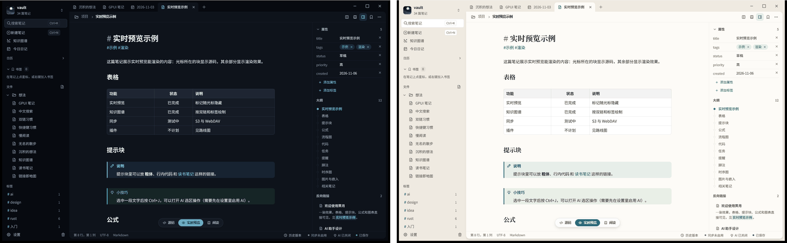<br><sub>墨色（左）与纸色（右）。</sub></p>

<table>
  <tr>
    <td align="center"><a href="docs/images/hero-paper.png">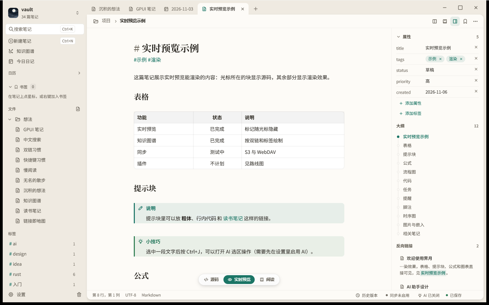</a><br><sub>纸色主题，笔记的实时预览。</sub></td>
    <td align="center"><a href="docs/images/widgets.png">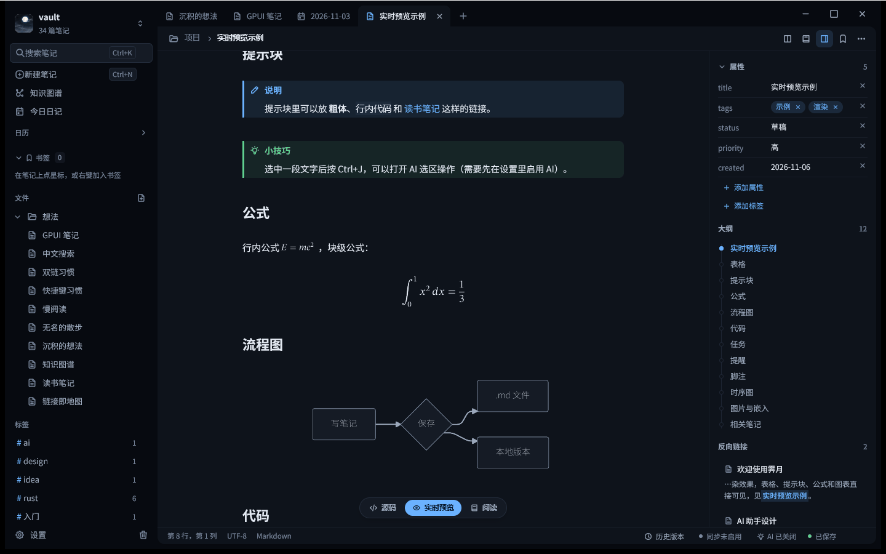</a><br><sub>预览中的提示块、公式和 Mermaid 流程图。</sub></td>
  </tr>
  <tr>
    <td align="center"><a href="docs/images/graph.png">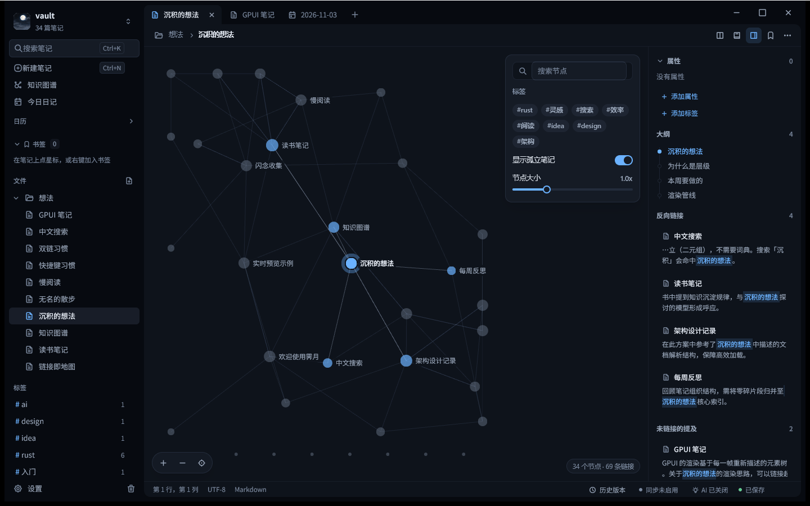</a><br><sub>知识图谱，由双链和标签构成。</sub></td>
    <td align="center"><a href="docs/images/search.png">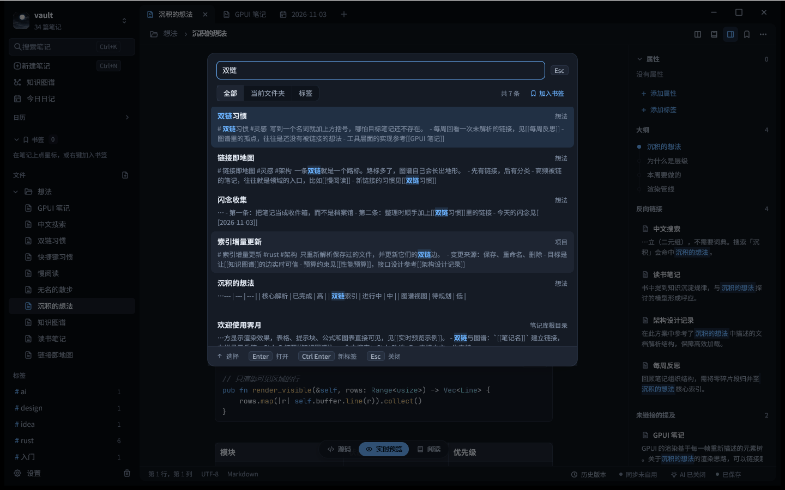</a><br><sub>中文全文搜索，结果中高亮命中的文字。</sub></td>
  </tr>
  <tr>
    <td align="center"><a href="docs/images/slash-menu.png">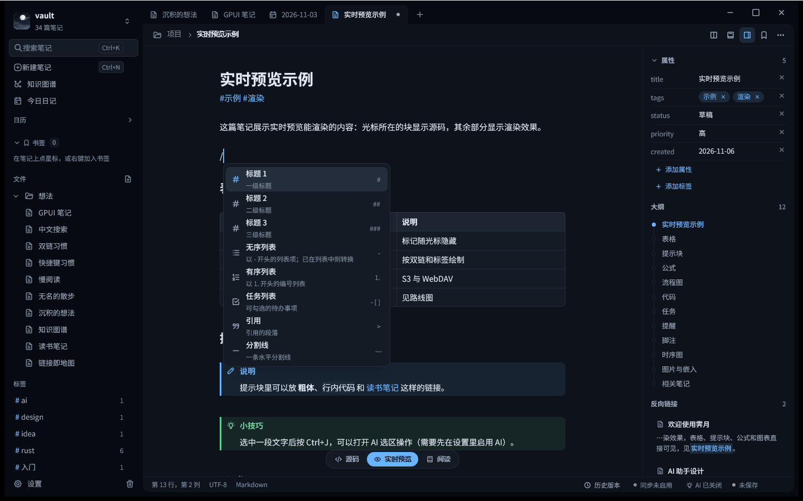</a><br><sub>输入 <code>/</code> 打开的插入菜单。</sub></td>
    <td align="center"><a href="docs/images/split-view.png">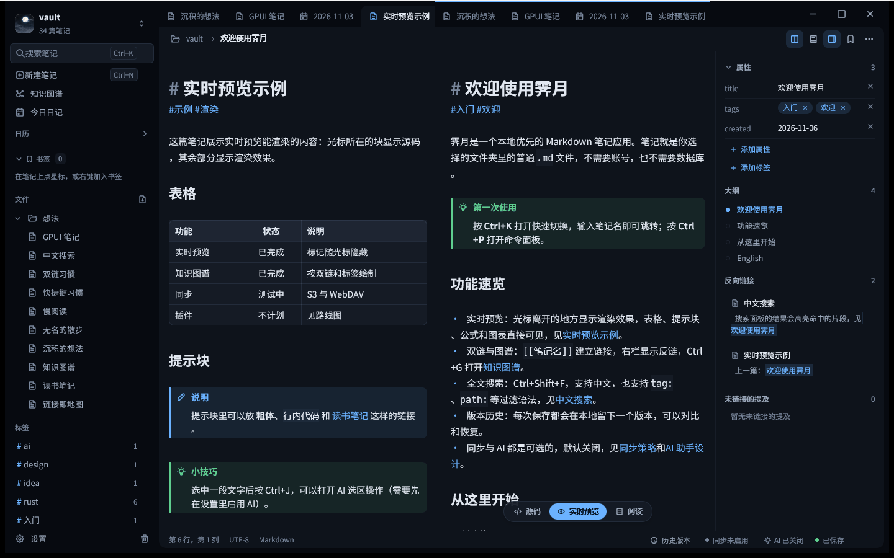</a><br><sub>分屏：两篇笔记并排显示。</sub></td>
  </tr>
  <tr>
    <td align="center"><a href="docs/images/palette.png">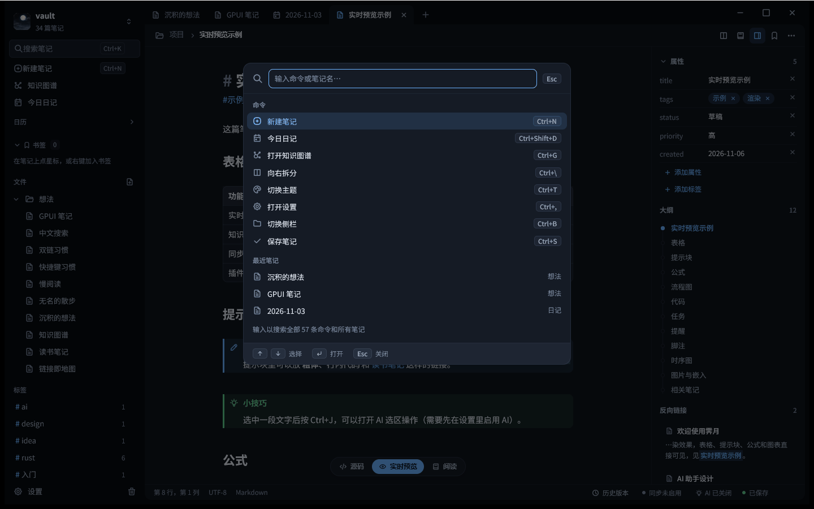</a><br><sub>命令面板（Ctrl+P）。</sub></td>
    <td align="center"><a href="docs/images/history.png">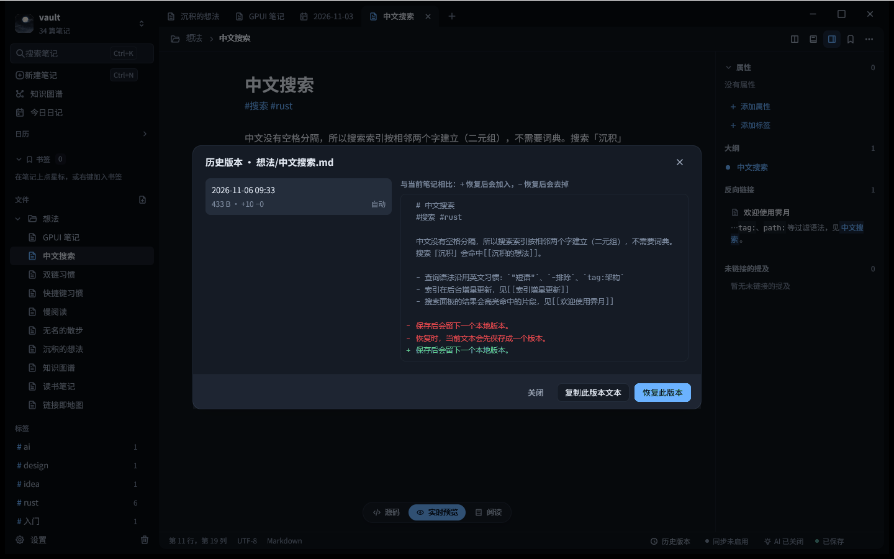</a><br><sub>本地历史版本：把某个版本与当前文本对比。</sub></td>
  </tr>
  <tr>
    <td align="center"><a href="docs/images/sync-settings.png">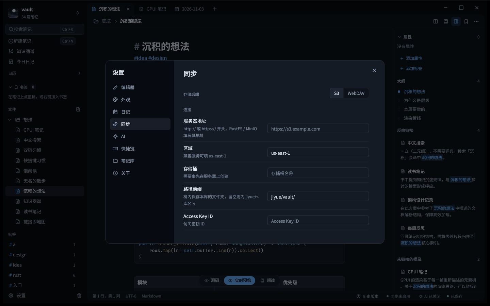</a><br><sub>同步设置页（空白，尚未配置服务器）。</sub></td>
    <td align="center"><a href="docs/images/bookmarks.png">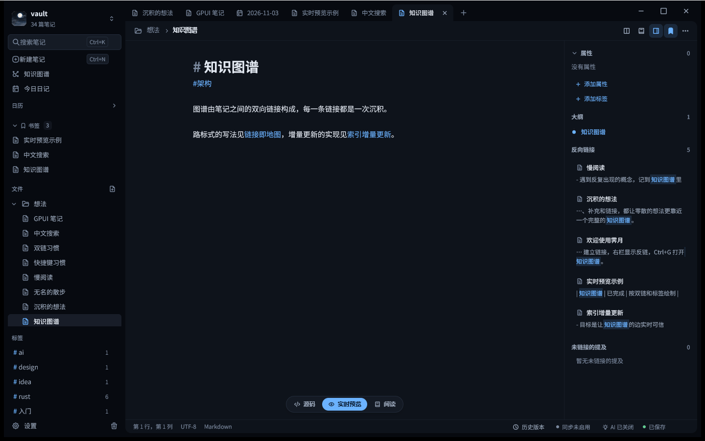</a><br><sub>侧栏中的书签区。</sub></td>
  </tr>
</table>

## 安装

- **Windows 10 和 11，x64 和 ARM64。** 从 [Releases](https://github.com/limitcool/jiyue/releases/latest) 下载 MSI 安装包（`Jiyue-<version>-x64.msi` 或 `Jiyue-<version>-arm64.msi`），按用户安装，不需要管理员权限。也可以从源码构建（见下文）。安装包尚未签名，SmartScreen 可能会提示警告。
- **macOS（Apple 芯片和 Intel）。** 从 [Releases](https://github.com/limitcool/jiyue/releases/latest) 下载 `.dmg`（`Jiyue_<version>_aarch64.dmg` 或 `Jiyue_<version>_x64.dmg`），把 `Jiyue.app` 拖进“应用程序”。应用尚未签名，首次打开请在访达里右键选择“打开”。
- **Linux，x86_64 和 ARM64。** 从 [Releases](https://github.com/limitcool/jiyue/releases/latest) 下载 `.deb`，或 AppImage（`chmod +x` 后直接运行）。每种架构各有一份。构建和测试流程见 [docs/ci.md](docs/ci.md)。

## 快速开始

```powershell
jiyue.exe --vault "D:\笔记"
```

- `--vault <文件夹>` 打开一个笔记库，文件夹不存在时会自动创建。
- 不带 `--vault` 时，霁月会打开上次使用的笔记库；第一次运行时则显示笔记库选择界面。
- Ctrl+N 新建笔记，Ctrl+K 打开笔记，Ctrl+Shift+D 打开今天的日记。
- 笔记会在停止输入一小段时间后自动保存，Ctrl+S 立即保存。

可选参数：`--theme <paper|ink|moss|graphite|fog>`（默认 `ink`），以及 `--open <界面>`，用来在启动时直接打开某个界面（例如 `palette`、`settings`、`graph`）。

## 从源码构建

需要：Windows 10 或 11（64 位），以及 [rust-toolchain.toml](rust-toolchain.toml) 中固定的 Rust 工具链（1.99.1，第一次构建时 `rustup` 会自动安装）。代码使用 Rust 2024 版。

```powershell
cargo run --release -p jiyue -- --vault "D:\笔记"
cargo build --release -p jiyue-mcp
```

生成的程序是 `target\release\jiyue.exe` 和 `target\release\jiyue-mcp.exe`。在 Linux 上，CI 使用的系统软件包列在 [docs/ci.md](docs/ci.md#linux-system-packages)。

## 键盘快捷键

以下是默认值。每个命令都可以在设置（Ctrl+,，「快捷键」页）中改成其他按键。完整列表见 [docs/shortcuts.md](docs/shortcuts.md)。

| 操作 | 按键 |
| --- | --- |
| 快速切换 | Ctrl+K（或 Ctrl+O） |
| 命令面板 | Ctrl+P |
| 新建笔记 / 今日日记 | Ctrl+N / Ctrl+Shift+D |
| 保存 | Ctrl+S |
| 搜索笔记库 | Ctrl+Shift+F |
| 当前笔记中查找 / 替换 | Ctrl+F / Ctrl+H |
| 知识图谱 | Ctrl+G |
| 切换侧栏 | Ctrl+B |
| 向右拆分 | Ctrl+\ |
| 切换主题 | Ctrl+T |
| 设置 | Ctrl+, |
| AI 助手面板 / 选区操作 | Ctrl+Shift+A / Ctrl+J |

## 数据与隐私

- 笔记是笔记库文件夹里的 `.md` 文件。霁月把自己的数据放在笔记库中一个隐藏的 `.jiyue` 文件夹里。随时可以删除它：你会失去历史版本、恢复副本、搜索索引和同步状态，但笔记不会丢失。
- `.jiyue` 中包含：搜索索引（`index/`）、本地历史（`history/`）、恢复副本（`recovery/`）、崩溃日志（`crash.log`），以及 AI、同步、附件、日记和模板的设置文件（不含密钥），还有同步状态（`sync/`）。删除的笔记放在 `.trash/`。
- 密码和 API 密钥以明文保存在用户配置目录的 `credentials.toml` 中，仅当前用户可读，不会写入笔记库，也不会同步或记入日志。详见 [docs/configuration.md](docs/configuration.md)。
- 只有开启同步或 AI 时才会使用网络。没有遥测，也不发送崩溃报告。AI 只发送你主动要求的内容，提问前会显示预览；你排除的文件夹和标签永远不会发送。

## 配置

设置保存在 TOML 文件中：用户配置目录下的 `config.toml` 与 `state.toml`，以及每个笔记库内的 `.jiyue/config.toml`。快捷键是 `config.toml` 的 `[keys]` 段。API 密钥和同步密钥保存在 `credentials.toml`（明文，仅当前用户可读）。出错时会显示文件、行和列，程序以默认值继续运行。完整说明见 [docs/configuration.md](docs/configuration.md)。

## 同步

同步是可选功能。首选 S3，也支持 WebDAV。两端的修改会尽量按行做三方合并；两端修改了同一处时，会在笔记旁边生成冲突副本，两个版本都会保留。S3 上的远端历史需要存储桶开启版本控制；霁月会检查这一点，但从不修改存储桶的设置。

WebDAV 已经实现，但还没有在真实服务器上验证过行为。请先用笔记库的副本测试同步。详见 [docs/sync.md](docs/sync.md)。

## AI 助手

AI 助手默认关闭。服务商、接口地址、模型名称和密钥都由你自己提供。侧栏面板可以围绕当前笔记、选中的文字或整个笔记库提问；选区菜单（Ctrl+J）可以改写、缩写、扩写、翻译、修正或总结选中的文字。结果以差异形式显示，接受之前不会写入笔记。详见 [docs/ai.md](docs/ai.md)。

## MCP 服务

`jiyue-mcp` 通过标准输入输出说 Model Context Protocol，只操作一个笔记库：

```powershell
jiyue-mcp --vault "D:\笔记" --read-only
```

它提供列出、读取和搜索笔记，查看反链、标签、属性和今日日记的工具；如果没有 `--read-only`，还可以新建和追加笔记、带哈希校验地更新笔记，以及设置属性。删除笔记需要 `--allow-delete`。客户端配置示例见 [docs/mcp.md](docs/mcp.md)。

## 项目状态

霁月目前是 Windows 上的 **测试版**。编辑器、实时预览、搜索、双链、图谱、历史版本、导出、同步和 MCP 服务都已经实现；同步和 AI 是测试最少的部分。计划做什么、不做什么，见 [路线图](ROADMAP.md)。

## 参与贡献

构建、测试和仓库结构见 [CONTRIBUTING.md](CONTRIBUTING.md)。安全问题请私下报告，方法见 [SECURITY.md](SECURITY.md)。

## 许可证

霁月采用 [MIT 许可证](LICENSE-MIT) 或 [Apache License 2.0](LICENSE-APACHE) 双重许可，由你选择其一。第三方组件及其许可证列在 [THIRD_PARTY_NOTICES.md](THIRD_PARTY_NOTICES.md) 中。

## 致谢

霁月建立在许多开源项目之上，其中包括：

- GPUI，来自 [Zed](https://github.com/zed-industries/zed) 编辑器的界面框架。
- [tantivy](https://github.com/quickwit-oss/tantivy)，全文搜索引擎。
- [opendal](https://github.com/apache/opendal)，S3 和 WebDAV 存储层。
- [pulldown-cmark](https://github.com/pulldown-cmark/pulldown-cmark)，Markdown 解析器。
- mermaid-rs-renderer（绘制 Mermaid 图表）和 latex-rust（渲染公式）。
- [similar](https://github.com/mitsuhiko/similar)（差异对比）、[toml](https://github.com/toml-rs/toml) 与 [toml_edit](https://github.com/toml-rs/toml)（配置文件）和 [notify](https://github.com/notify-rs/notify)（文件监听）。
- [Tabler Icons](https://tabler.io/icons)（MIT 许可），界面使用的图标集。

完整的 crate 和许可证列表见 [THIRD_PARTY_NOTICES.md](THIRD_PARTY_NOTICES.md)。
