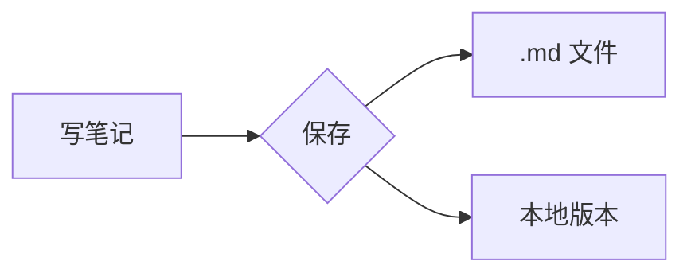
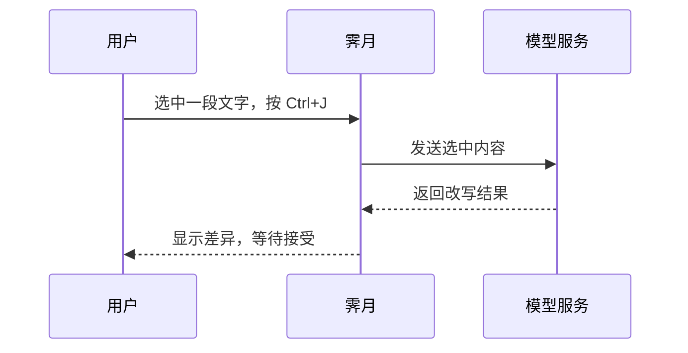

# 实时预览示例
#示例 #渲染

这篇笔记展示实时预览能渲染的内容：光标所在的块显示源码，其余部分显示渲染效果。

## 表格

| 功能 | 状态 | 说明 |
| --- | :---: | --- |
| 实时预览 | 已完成 | 标记随光标隐藏 |
| 知识图谱 | 已完成 | 按双链和标签绘制 |
| 同步 | 测试中 | S3 与 WebDAV |
| 插件 | 不计划 | 见路线图 |

## 提示块

> [!note] 说明
> 提示块里可以放 **粗体**、`行内代码` 和 [[读书笔记]] 这样的链接。

> [!tip] 小技巧
> 选中一段文字后按 Ctrl+J，可以打开 AI 选区操作（需要先在设置里启用 AI）。

## 公式

行内公式 $E=mc^2$，块级公式：

$$
\int_0^1 x^2 \, dx = \frac{1}{3}
$$

## 流程图



## 代码

```rust
fn greet(name: &str) -> String {
    format!("你好，{name}！")
}
```

## 任务

- [x] 写下第一条想法
- [x] 链接到相关笔记
- [ ] 整理 [[闪念收集]] 里的念头

## 提醒

> [!warning] 注意
> 同步前请确认远端存储桶已开启版本控制，否则无法恢复远端历史。

> [!danger]- 折叠的提示
> 这一块默认是折叠的，点击标题即可展开。

## 脚注

霁月的预览支持脚注[^1]，脚注的定义会收集到文末。

[^1]: 脚注定义写在任意位置，预览里统一显示在底部。

## 时序图



## 图片与嵌入

![[jiyue-gradient.png]]

下面是一篇笔记的嵌入：

![[卡片盒方法]]

## 相关笔记

- 上一篇：[[欢迎使用霁月]]
- 图谱入口：[[知识图谱]]
