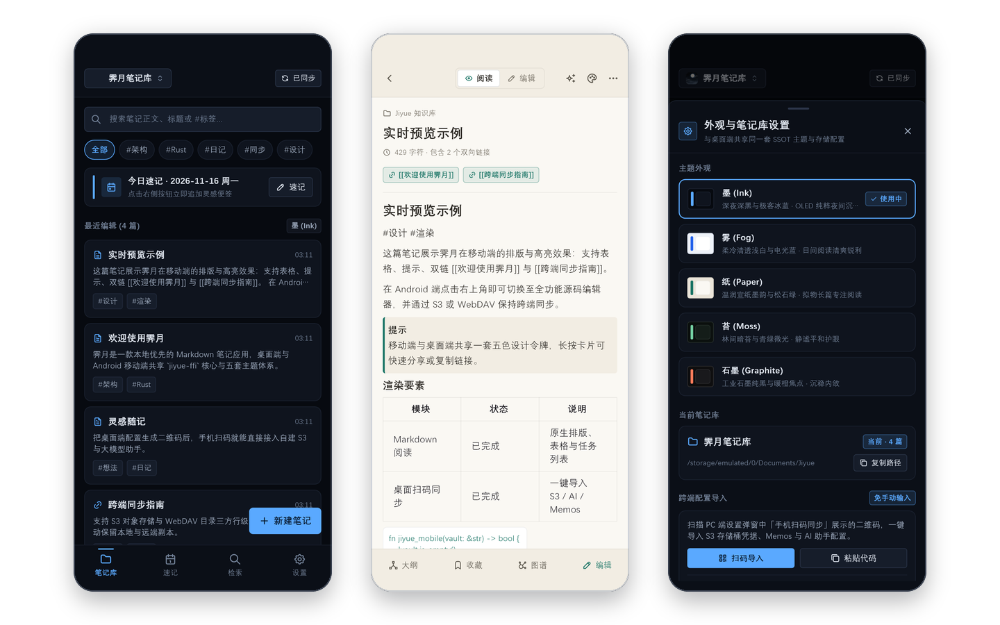

# 霁月 Android 客户端 (`jiyue_mobile`)

霁月 Jiyue 的 Android 移动端客户端，基于 Flutter 构建，并通过 Rust C-ABI (`jiyue-ffi`) 与桌面端共享底层笔记存储、双链提取及跨端同步能力。详细项目介绍与桌面端说明见[主仓库 README](../README.md)。

<p align="center">
  <a href="../docs/images/mobile.png"></a>
  <br>
  <sub>玄墨（Ink）笔记库首页、宣纸（Paper）阅读视图与设置中心。</sub>
</p>

## 架构概览

- **UI 与状态管理**：基于 Flutter 与 Material 3 构建，遵循单一数据源设计令牌 [`design/tokens.json`](../design/tokens.json)（SSOT v3.0），与桌面端共享**墨（Ink）**、**雾（Fog）**、**纸（Paper）**、**苔（Moss）**、**石墨（Graphite）**五套内置主题配色。
- **Rust FFI 内核 (`jiyue-ffi`)**：在 Android 上加载 `libjiyue_ffi.so`（不可用时安全回退至本地 `dart:io` 实现），统一处理笔记目录列表、读写、日记生成与 S3 / WebDAV 同步配置。

## 主要功能

- **笔记库浏览与快速检索**：按笔记名称、正文与 `#标签` 筛选并浏览本地 `.md` 笔记，支持新建与编辑。
- **Markdown 阅读与源码编辑**：渲染标题、提示引用、表格、代码块、任务列表及双向链接 `[[笔记名]]`，并可一键切换源码编辑模式。
- **今日速记**：随时通过底部入口或首页卡片向当日日记按时间戳追加随笔。
- **待办与 Memos 微记**：连接自托管 Memos 服务，查看、筛选并发送微记，或插入当前笔记。
- **S3 / WebDAV 云端同步**：兼容自建 MinIO / RustFS / AWS S3 与 WebDAV，支持测试连接与手工配置。
- **桌面二维码扫码导入**：扫描桌面端设置页「手机扫码同步」展示的二维码（或粘贴导出配置文本），一键导入 S3、AI 与 Memos 参数，免去手动输入。
- **AI 助手与选区润色**：支持自带密钥接入 OpenAI 兼容或 Anthropic 接口，对当前笔记进行改写、总结、翻译或对比预览应用。
- **应用内更新**：在设置页检查 GitHub Releases 最新版本，展示下载百分比并调起 Android 系统安装器直接覆盖升级。

## 本地开发、静态检查与测试

确保已安装 Flutter SDK 并位于本目录（`mobile/`）下运行：

```powershell
flutter pub get
flutter analyze
flutter test
```

## 构建与签名配置

### 调试版 / 本地构建

```powershell
flutter build apk --release
```

当未提供发布签名凭据时，[`android/app/build.gradle.kts`](android/app/build.gradle.kts) 会自动回退至 debug 签名，方便本地真机调试。

### 正式发布签名

生产发布与 CI 流水线（见 [`.github/workflows/release.yml`](../.github/workflows/release.yml)）通过以下两种方式之一注入正式签名证书（满足其一即可）：

1. **`android/key.properties` 文件**（不要提交至版本库）：包含 `storeFile`、`storePassword`、`keyAlias`、`keyPassword`；
2. **环境变量**：设置 `ANDROID_KEYSTORE_PATH`、`ANDROID_KEYSTORE_PASSWORD`、`ANDROID_KEY_ALIAS`、`ANDROID_KEY_PASSWORD`。

拥有正式签名的 Release APK（`Jiyue-<version>-android.apk`）均会随每个版本 Tag 自动构建并发布至 [GitHub Releases](https://github.com/limitcool/jiyue/releases/latest)，同一签名证书发布的后续版本可直接覆盖安装升级，无需先卸载旧版。
